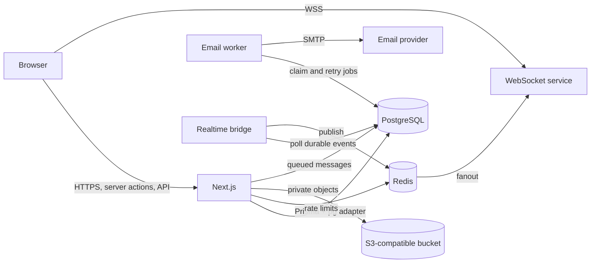

# TeamFlow

TeamFlow is a multi-workspace project management application built with Next.js 16, TypeScript, Tailwind CSS, Radix/shadcn-style UI components, PostgreSQL, Prisma 7, and Redis. It includes authenticated workspaces, projects, tasks, sprints, collaboration, reporting, and a versioned task API.

## What works

- Email/password registration, verification, login, password reset, revocable database sessions, logout, and optional Google OAuth.
- Multiple workspaces, workspace switching, invitations, role changes and membership revocation, owner/admin/manager/member/guest permissions, project creation and archiving, project members, and administrative audit records.
- Tasks and subtasks, assignment, due dates, priorities, labels, custom workflow statuses, dependencies, comments, private attachments, manager-controlled deletion, search, sorting, filtering, bulk status action, list, board, and calendar views.
- Sprint planning, backlog assignment, story points, velocity, burndown, and a completion snapshot.
- In-app notifications, email jobs with a retrying worker, notification preferences, durable workspace events, and a reconnecting WebSocket client backed by Redis. Local development can use SSE without the realtime workers.
- Dashboard, reports, light/dark themes, keyboard search shortcut, loading skeleton, error page, and accessible Radix dialog.
- Tenant checked server actions and API routes, version checked task updates, Redis rate limits in production, and private S3-compatible storage in production.

## Run locally

1. Install Node.js 24 and Docker. Copy `.env.example` to `.env`.
2. Run `docker compose up -d`.
3. Run `npm ci`, `npx prisma generate`, and `npx prisma migrate deploy`.
4. Optionally set a unique `DEMO_PASSWORD` of at least 12 characters and run `npm run db:seed` for an Acme Studio demo account (`demo@teamflow.local`). The seed is idempotent and refuses to run with `NODE_ENV=production`.
5. Start the app with `npm run dev`. In another terminal, run `npm run worker` to deliver queued email notifications. To exercise the WebSocket path locally, set `NEXT_PUBLIC_REALTIME_WS_URL=ws://localhost:3001/realtime` before starting Next.js and run `npm run realtime:bridge` and `npm run realtime:server` in separate terminals.
6. Open [http://127.0.0.1:3000](http://127.0.0.1:3000). Without SMTP, verification, reset, and invitation links appear as private files in `.data/outbox`. Without S3 configuration, attachments are stored in `.data/attachments`.

Do not run the seed in production. Local email and file adapters refuse to run in production. Use SMTP, S3, Redis, PostgreSQL, and HTTPS as described in [DEPLOYMENT.md](DEPLOYMENT.md).

## Checks

Run `npm run lint`, `npm run typecheck`, `npm test`, `npm test -- --coverage`, `npm run test:e2e`, and `npm run build`. Integration tests run when `TEST_DATABASE_URL` points to a disposable PostgreSQL database; set `TEST_REDIS_URL` to include the WebSocket tests. Playwright needs Chromium (`npx playwright install chromium`). The CI workflow provisions PostgreSQL, applies migrations, audits dependencies, installs Chromium, and runs the checks.

## Architecture

Every tenant query starts from the authenticated user's membership. Role checks run on the server for each mutation. Task edits use a version field to reject stale updates. Workspace events are stored durably, then published over Redis to authenticated WebSocket clients with event IDs and replay on reconnect. The local SSE adapter is available without Redis. Important project and member changes are written to an administrative audit log.

See [API.md](API.md) for routes, [DEPLOYMENT.md](DEPLOYMENT.md) for the deployment checklist, and [`prisma/schema.prisma`](prisma/schema.prisma) for the data model.

## Current production limits

The current production-readiness review is in [docs/production-readiness-review.md](docs/production-readiness-review.md). Authentication uses application-owned session and account code rather than Auth.js or another maintained auth framework; it needs independent review or replacement before sensitive production use. Google OAuth is hidden until configured and cannot yet link to an existing password account. Live SMTP, S3, Google, and hosting integrations require validation with real credentials. The Docker Compose configuration parses, but the Docker daemon was unavailable for a fresh image build in this review. The Redis-backed WebSocket service needs load testing. Dashboard totals are exact while search and task rows use the 100 most recent records, showing up to 20 at a time; the All tasks page and API paginate full collections. The board, calendar, and notification views have fixed limits, and reports still load complete tenant collections. Burndown uses current task completion timestamps rather than historical event reconstruction. The platform administrator page offers operational visibility, while provisioning that role is done from a trusted terminal. The configured GitHub Actions workflow has not been verified remotely for this revision. A backup restore exercise is still required before accepting real data.

## Screenshots

Sample screenshots are in [`docs/screenshots/dashboard.png`](docs/screenshots/dashboard.png) and [`docs/screenshots/reports.png`](docs/screenshots/reports.png). To capture additional views, sign in with the demo account and visit `/board` and `/sprints`.
